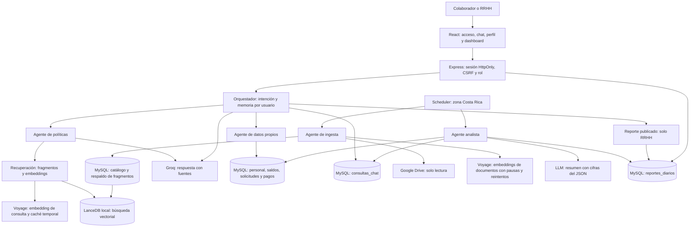

# Arquitectura de Nuvexa

Drive conserva los originales. El agente de ingesta extrae texto y metadatos y genera embeddings de documentos con Voyage; sus pausas no se transfieren a la cola del chat. Las consultas usan el mismo modelo y dimensión, con caché temporal de sus vectores. MySQL conserva catálogo, fragmentos y personal separados. LanceDB ejecuta la búsqueda vectorial. Groq selecciona pasajes que se validan literalmente y redacta la recomendación del resumen; las cifras del reporte se vinculan a etiquetas en código. El scheduler inicia reporte y Drive independientemente. No se llama a la API de OpenAI; se mantienen proveedores local y mock como alternativas explícitas.

Las políticas locales 1.1 están preparadas para revisión/publicación. La evidencia real corresponde a los archivos de Drive durante la evaluación; no se asume que la copia local ya fue publicada.
