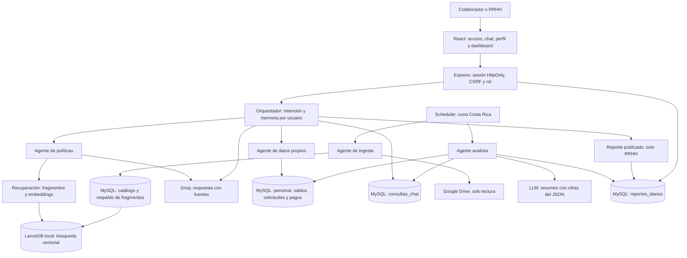

# Arquitectura de Nuvexa

Drive conserva los originales. El agente de ingesta descarga únicamente para extraer texto, metadatos y fragmentos; genera embeddings multilingües localmente con Transformers.js. MySQL mantiene el catálogo transaccional de la base existente y los datos del personal en tablas separadas. LanceDB es la base vectorial local reconstruible y ejecuta la búsqueda por coseno. No requiere Docker ni un servidor adicional. Groq clasifica consultas, redacta respuestas documentales con citas y genera el resumen del analista; no se llama a la API de OpenAI.
